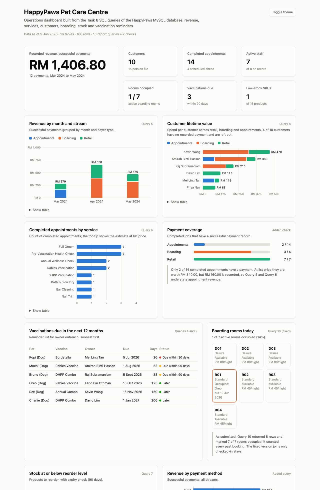
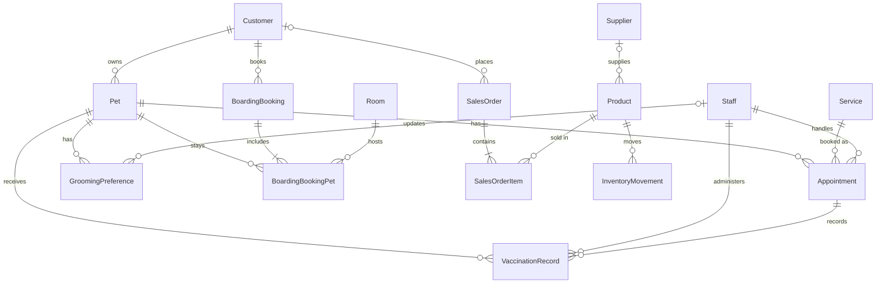

# HappyPaws Database

MySQL database for a pet-care centre that runs grooming, vet appointments, boarding and a retail shop. 16 tables in 3NF, sample data, 10 business queries and an operations dashboard built from those queries.

Group project for ECM202 Database Technology and Applications (XMUM, June 2026), team of 7. I was group leader and worked on Tasks 4-9: ERD, relational schema and normalisation, database creation, data population, SQL queries and the database administration plan.

**Dashboard:** https://kweuu.github.io/happypaws-database/



## Schema

16 tables covering customers and pets, staff and services, appointments, vaccinations, grooming preferences, boarding, retail sales, inventory and payments.



`Payment` is polymorphic: `PayerType` + `PayerRefID` point to a sales order, an appointment or a boarding booking, so it has no foreign key. Integrity rules live in `CHECK` constraints (non-negative prices and stock, end time after start, next vaccine date after the last one) and in `ON DELETE RESTRICT / SET NULL` on every foreign key.

## Queries

All 10 are in [`sql/happypaws.sql`](sql/happypaws.sql) with a technical and a business note each.

| # | Question | SQL used |
|---|---|---|
| 1 | Which staff are active, by role? | filter, sort |
| 2 | Who owns each pet and how to reach them? | inner join |
| 3 | What is on the appointment schedule? | 5-table join |
| 4 | When was each pet vaccinated, when is the next dose? | joins, `DATEDIFF` |
| 5 | Revenue by month and stream | `GROUP BY`, `SUM`, `COUNT` |
| 6 | Most requested services | join, aggregate |
| 7 | Products at or below reorder level, expiring stock | `LEFT JOIN`, `CASE` |
| 8 | Customer lifetime value across retail, boarding and appointments | 3 derived tables, `COALESCE` |
| 9 | Vaccinations due in the next 12 months | date range filter |
| 10 | Which boarding rooms are occupied today? | `LEFT JOIN`, `CASE` |

## Findings (data as of 9 June 2026)

- Recorded revenue is RM 1,406.80 from 12 payments. Boarding brings in half of it from 3 paid stays.
- The top two customers account for 60% of revenue.
- Only 2 of 14 completed appointments have a payment record. At list price they are worth RM 840, but RM 160 is recorded, so the revenue and lifetime-value queries understate appointment income. This is the main data-quality gap in the sample data.
- 3 vaccinations fall due within 90 days, a ready reminder list for reception.
- The only low-stock product is also past its expiry date.

## Fix after submission

Query 10 as submitted put the `Status = 'Checked-In'` filter on the `BoardingBooking` join but checked `BoardingBookingPet` in the `CASE`. Every room that ever had a booking came out as occupied (7 of 7), and a room booked twice appeared twice. The corrected version in [`sql/queries_sqlite.sql`](sql/queries_sqlite.sql) joins only checked-in stays and returns 1 of 7. Both versions are kept so the difference is visible.

## Run

**MySQL** (Workbench or CLI): run `sql/happypaws.sql`. It drops and recreates the `happypaws` database, loads the data and runs the queries.

```bash
mysql -u root -p < sql/happypaws.sql
```

**Dashboard** (Python 3, standard library only): the build script loads the MySQL dump into an in-memory SQLite database, runs SQLite ports of the queries and writes `docs/data.js`.

```bash
python3 analysis/build_dashboard.py
python3 -m http.server --directory docs 8000
```

`CURDATE()` is pinned to 9 June 2026 so the results match the report; pass `--as-of YYYY-MM-DD` to change it.

## Stack

MySQL, MySQL Workbench, SQLite, Python, HTML/SVG/JavaScript (no chart library)

## Structure

```
sql/happypaws.sql          schema, sample data and the 10 queries (MySQL)
sql/queries_sqlite.sql     SQLite ports used by the dashboard, plus the Query 10 fix
analysis/build_dashboard.py  loads the dump into SQLite and exports query results
docs/                      dashboard (GitHub Pages)
```

All names, phone numbers and emails in the data are fictional.
